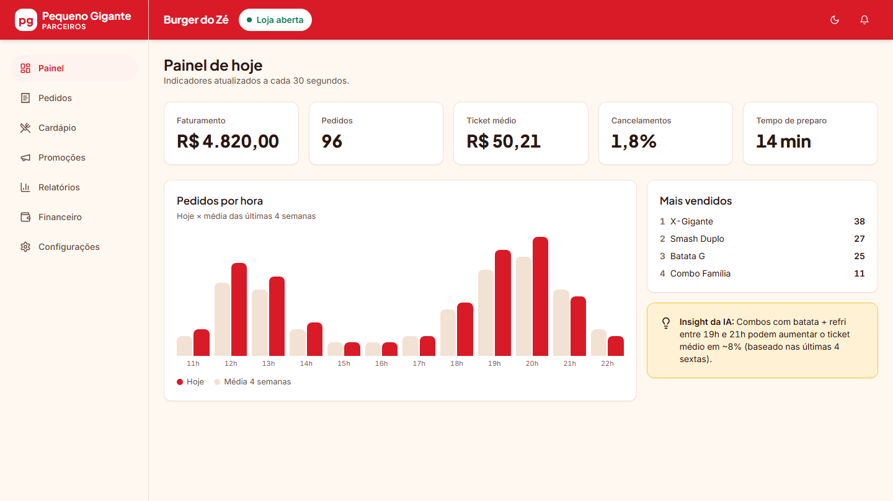
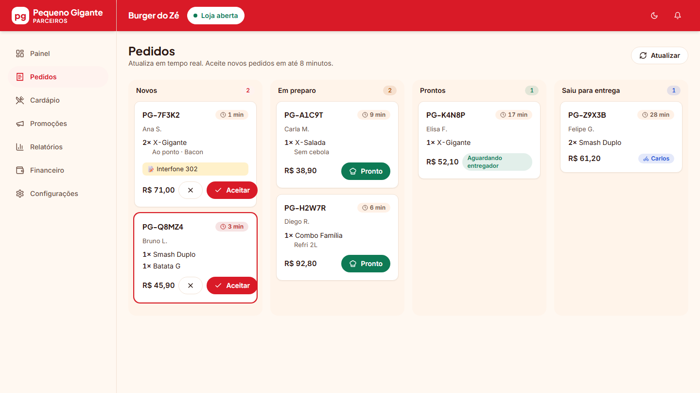
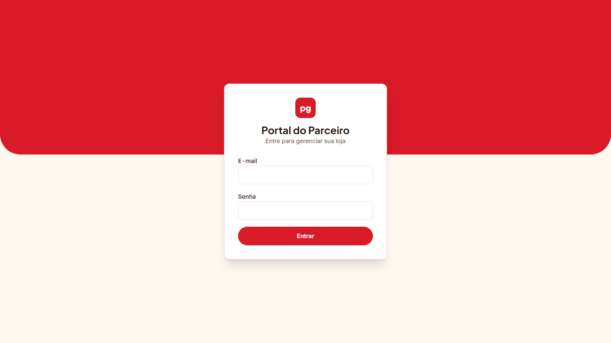
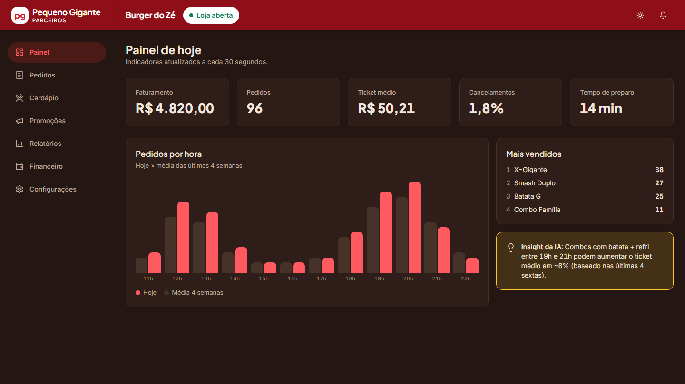
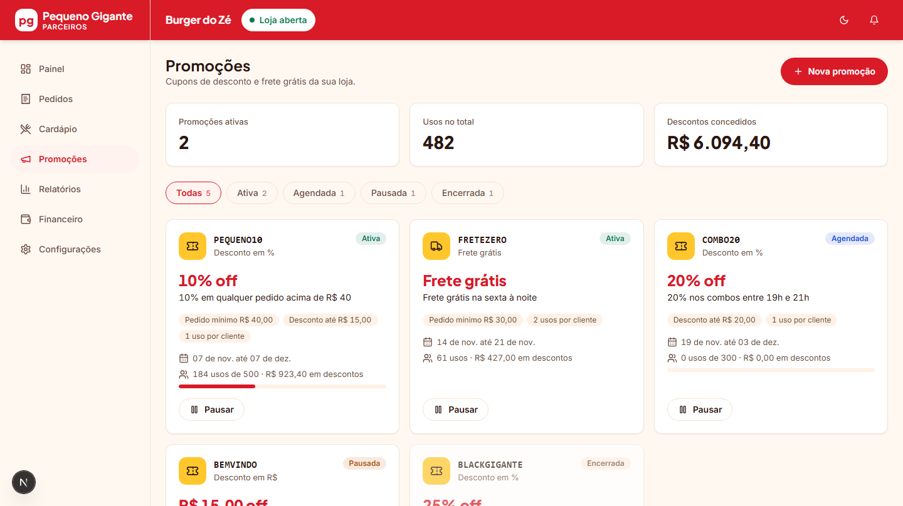
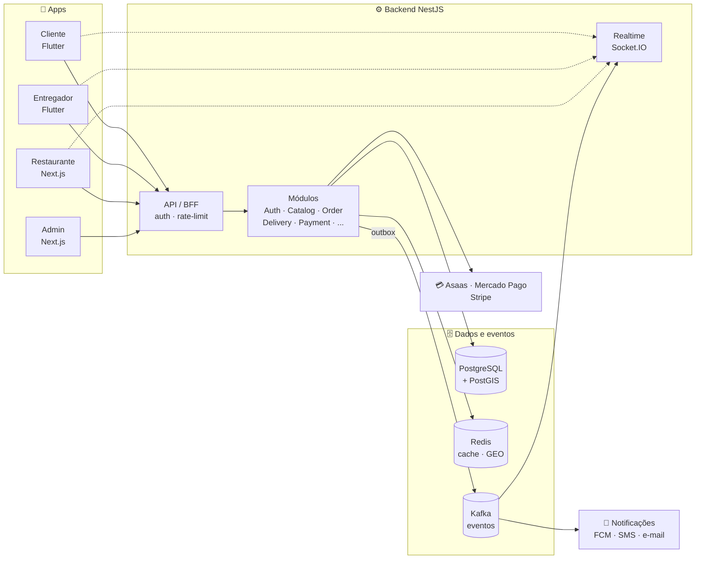
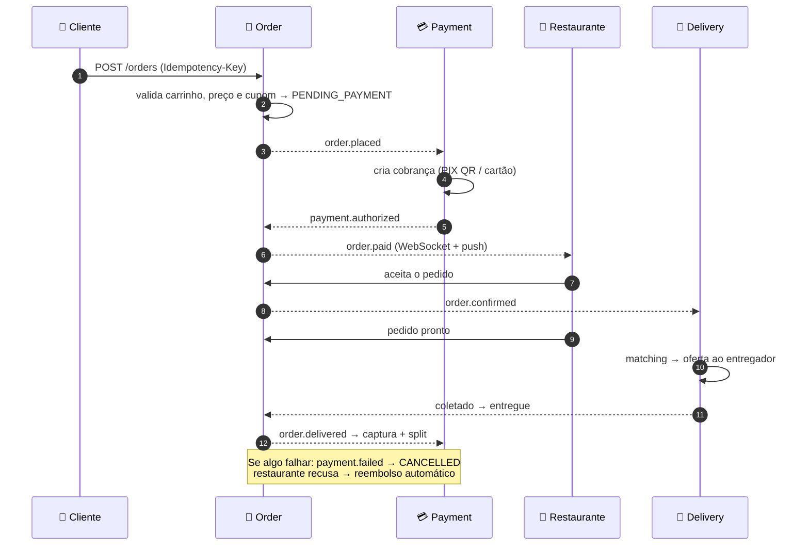
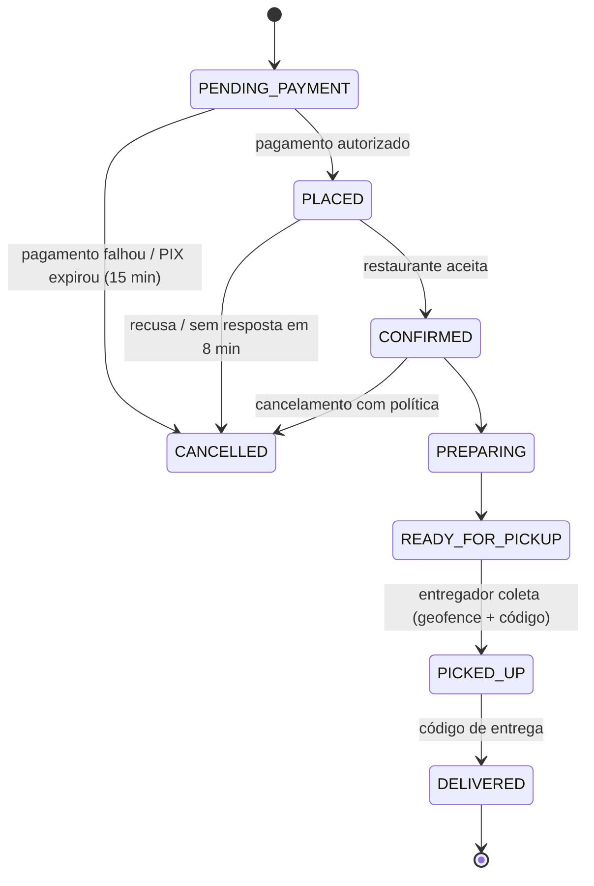
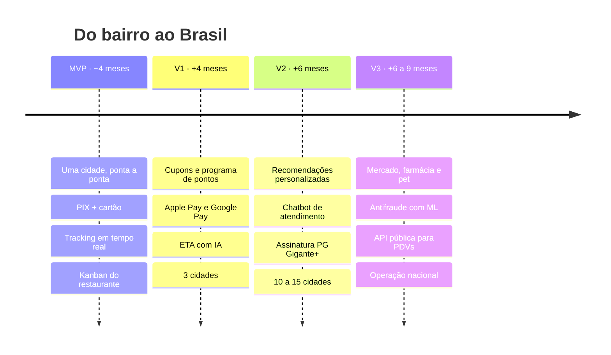

<div align="center">


# PG Delivery

### Pequeno Gigante Delivery · o delivery que nasce pequeno e pensa grande 🍔🛵

Ecossistema completo de delivery: **app do cliente**, **app do entregador**, **painel do restaurante** e **admin**,<br/>
sobre um backend orientado a eventos e pronto para virar microsserviços.

<br/>


<br/>


**[✨ Ver telas](#-telas)** ·
**[🚀 Rodar em 1 minuto](#-rodar-em-1-minuto)** ·
**[🏗️ Arquitetura](#️-arquitetura)** ·
**[🗺️ Roadmap](#️-roadmap)** ·
**[📚 Documentação](#-documentação)**

<br/>

<picture>
  <source media="(prefers-color-scheme: dark)" srcset="docs/assets/dashboard-dark.png" />
  
</picture>

<sub>💡 A imagem acima segue o tema do seu GitHub: troque para o modo escuro e veja a versão noturna.</sub>

</div>

---

## 🍽️ O que é

O **PG Delivery** é uma plataforma de delivery pensada para começar numa cidade e crescer até virar operação nacional. São quatro produtos conversando com o mesmo backend:

| | Produto | Para quem | Tecnologia | Neste repositório |
|:---:|---|---|---|---|
| 📱 | **App do Cliente** | Quem está com fome | Flutter 3 | ✅ Home, sacola, checkout PIX e tracking |
| 🛵 | **App do Entregador** | Quem entrega | Flutter 3 (reaproveita o `core/` do cliente) | 🗓️ Planejado no MVP |
| 🏪 | **Painel do Restaurante** | Quem cozinha | Next.js 15 | ✅ Dashboard, kanban de pedidos e promoções · 🚧 cardápio |
| 🛡️ | **Admin Master** | Quem opera a plataforma | Next.js 15 | 🗓️ Planejado no MVP |

### Destaques

- ⚡ **Tempo real de verdade:** WebSocket (Socket.IO + Redis) e Redis GEO para acompanhar o entregador com latência abaixo de 1 s.
- 🧾 **Pedidos que não somem:** saga do pedido orientada a eventos, *outbox pattern* e `Idempotency-Key` em toda operação sensível.
- 💸 **Pagamento brasileiro:** PIX e cartão com *split* automático (Asaas / Mercado Pago), com Stripe como plano B.
- 🤖 **IA desde o início:** insights para o restaurante, ETA por modelo de regressão e recomendações no roadmap.
- ♿ **Acessível:** todas as cores passam no contraste WCAG 2.2 AA, com alvos de toque de 44 px e anúncios para leitor de tela no tracking.
- 🌗 **Tema claro e escuro** no painel e no app.

---

## ✨ Telas

<table>
  <tr>
    <td width="50%" align="center">
      <br/>
      <b>Kanban de pedidos</b><br/>
      <sub>Aceitar, marcar como pronto e acompanhar a entrega. Pedidos atrasados ganham destaque vermelho.</sub>
    </td>
    <td width="50%" align="center">
      <br/>
      <b>Portal do Parceiro</b><br/>
      <sub>Login com sessão em cookie HttpOnly via BFF do Next.js.</sub>
    </td>
  </tr>
  <tr>
    <td width="50%" align="center">
      <br/>
      <b>Dashboard · tema claro</b>
    </td>
    <td width="50%" align="center">
      <br/>
      <b>Dashboard · tema escuro</b>
    </td>
  </tr>
  <tr>
    <td width="50%" align="center">
      <picture>
        <source media="(prefers-color-scheme: dark)" srcset="docs/assets/promotions-dark.png" />
        
      </picture><br/>
      <b>Promoções</b><br/>
      <sub>Cupons de desconto e frete grátis com filtros por situação, pausar/reativar e criação.</sub>
    </td>
    <td width="50%" align="center">
    </td>
  </tr>
</table>

---

## 🚀 Rodar em 1 minuto

O painel web tem um **modo demonstração** com dados de exemplo. Você não precisa de banco, Docker nem backend, só do **Node.js 22+**:

```bash
git clone https://github.com/th3oph1l0/pg-delivery.git
cd pg-delivery/web
cp .env.example .env.local     # já vem com NEXT_PUBLIC_DEMO=true
npm install
npm run dev
```

Abra **http://localhost:3001/dashboard** e pronto. 🎉

| Página | Endereço |
|---|---|
| 📊 Painel | http://localhost:3001/dashboard |
| 🧾 Pedidos (kanban) | http://localhost:3001/orders |
| 🎟️ Promoções | http://localhost:3001/promotions |
| 🍔 Cardápio (em construção) | http://localhost:3001/menu |

> [!TIP]
> No modo demonstração não há login: todas as páginas do painel ficam liberadas. Para usar a API de verdade, troque `NEXT_PUBLIC_DEMO` para `false` e suba o ambiente completo abaixo.

<details>
<summary><b>🧰 Ambiente completo (infra + backend + web + mobile)</b></summary>

<br/>

**Pré-requisitos:** Node.js 22+, Docker Desktop, Flutter 3 (só para o mobile) e `psql`.

**1. Infra local** (Postgres + PostGIS, Redis, Redpanda/Kafka, Jaeger e Grafana)

```bash
cd infra/docker && docker compose up -d
```

**2. Backend**

```bash
cd backend
cp .env.example .env
npm install
npx prisma migrate dev --name init
psql postgresql://pg:pg@localhost:5432/pgdelivery -f prisma/sql/001_postgis_indexes_partitions.sql
npm run db:seed
npm run start:dev
```

**3. Web**

```bash
cd web && cp .env.example .env.local   # ajuste NEXT_PUBLIC_DEMO=false
npm install && npm run dev
```

**4. Mobile** (gera as pastas `android/` e `ios/` na primeira vez)

```bash
cd mobile
flutter create --platforms=android,ios --org br.com.pgdelivery .
flutter pub get && flutter test
flutter run --dart-define=API_URL=http://10.0.2.2:3000/v1 --dart-define=RT_URL=http://10.0.2.2:3000/rt
```

> [!NOTE]
> Antes de rodar o app, configure a chave do Google Maps em `android/app/src/main/AndroidManifest.xml` e `ios/Runner/AppDelegate.swift`.

</details>

<details>
<summary><b>🔌 Portas e endereços locais</b></summary>

<br/>

| Serviço | Endereço |
|---|---|
| 🏪 Painel web | http://localhost:3001 |
| ⚙️ API REST | http://localhost:3000/v1 |
| 📖 Swagger (docs da API) | http://localhost:3000/api/docs |
| 📡 Tempo real (Socket.IO) | http://localhost:3000/rt |
| 🐘 PostgreSQL | `localhost:5432` (usuário `pg`, senha `pg`) |
| 🔴 Redis | `localhost:6379` |
| 📨 Kafka (Redpanda) | `localhost:19092` |
| 🖥️ Redpanda Console | http://localhost:8080 |
| 🔎 Jaeger (tracing) | http://localhost:16686 |
| 📊 Grafana | http://localhost:3002 |

</details>

---

## 🏗️ Arquitetura

**Monólito modular** no MVP, já com as fronteiras DDD dos 12 serviços desenhadas. Cada módulo pode virar um microsserviço quando a escala pedir.



<details>
<summary><b>🔄 Saga do pedido: do "fazer pedido" ao "entregue"</b></summary>

<br/>



</details>

<details>
<summary><b>🚦 Máquina de estados do pedido</b></summary>

<br/>



</details>

<details>
<summary><b>🧠 Decisões de arquitetura (e por quê)</b></summary>

<br/>

| Tema | Decisão | Por quê |
|---|---|---|
| Mensageria | **Kafka** (MSK) para eventos de domínio + **SQS** para filas de tarefas | Replay, ordenação por `orderId`, alto volume de GPS e vários consumidores (BI, IA, antifraude) |
| Topologia | **Monólito modular** no MVP, com extração progressiva | Equipe pequena entrega mais rápido, e as fronteiras DDD já ficam prontas |
| Orquestração | **ECS Fargate** no MVP/V1 → **EKS** a partir da V2 | Menos custo operacional no começo |
| Tracking | **Socket.IO + Redis adapter** e **Redis GEO** | Latência < 1 s e consulta espacial barata |
| Pagamentos | **Asaas / Mercado Pago** (PIX + split), **Stripe** como secundário | Split nativo e PIX mais barato no Brasil |

</details>

---

## 🧱 Stack

<table>
  <tr>
    <th>⚙️ Backend</th>
    <th>🏪 Web</th>
    <th>📱 Mobile</th>
    <th>☁️ Infra e DevOps</th>
  </tr>
  <tr valign="top">
    <td>
      NestJS 11<br/>
      Prisma 6<br/>
      CQRS + DDD<br/>
      Kafka (kafkajs)<br/>
      Socket.IO<br/>
      Argon2 + JWT<br/>
      Swagger
    </td>
    <td>
      Next.js 15 + React 19<br/>
      Tailwind CSS 4<br/>
      TanStack Query<br/>
      Zustand<br/>
      next-themes<br/>
      Lucide icons
    </td>
    <td>
      Flutter 3 + Material 3<br/>
      Riverpod 3<br/>
      GoRouter<br/>
      Dio<br/>
      Google Maps<br/>
      Socket.IO client
    </td>
    <td>
      Docker Compose<br/>
      Kubernetes<br/>
      Terraform (AWS)<br/>
      GitHub Actions<br/>
      Sonar · Trivy · Gitleaks<br/>
      Jaeger · Grafana
    </td>
  </tr>
</table>

<details>
<summary><b>📂 Estrutura de pastas</b></summary>

<br/>

```text
pg-delivery/
├── backend/         ⚙️  NestJS + Prisma + Kafka (Clean Architecture, módulos DDD)
│   ├── prisma/          schema, seed e SQL de índices PostGIS/partições
│   └── src/modules/     auth · catalog · order · delivery · health
├── web/             🏪  Next.js 15: painel do restaurante e admin
│   └── src/             app/ (rotas) · components/ · features/ · stores/
├── mobile/          📱  Flutter 3: app do cliente (base do app do entregador)
│   └── lib/             core/ (design system, rede, rotas) · features/
├── infra/           ☁️  docker/ · k8s/ · terraform/
├── docs/            📚  14 documentos: arquitetura, BD, APIs, custos...
└── .github/         🤖  CI/CD: lint, testes, segurança, build e deploy
```

</details>

---

## 🎨 Design System "Gigante"

Uma paleta pensada para **abrir o apetite**: vermelho ketchup, amarelo queijo e fundos creme.

| | Token | Cor | Uso |
|:---:|---|---|---|
|  | `primary` | `#D91A27` Vermelho Ketchup | Botões, links e a faixa do topo |
|  | `primary-pressed` | `#B5121D` | Botão pressionado |
|  | `accent` | `#FFC72C` Amarelo Queijo | Destaques, promoções e fidelidade |
|  | `secondary` | `#0E7A55` Verde Folha | Frete grátis, sucesso e "loja aberta" |
|  | `surface` | `#FFF8F1` Creme | Fundo das páginas |
|  | `foreground` | `#2A1712` Marrom Café | Textos |
|  | `header` (escuro) | `#8E0F18` Vinho | Faixa do topo no tema escuro |

Os mesmos tokens existem no web ([`globals.css`](web/src/app/globals.css)) e no mobile ([`pg_tokens.dart`](mobile/lib/core/design_system/tokens/pg_tokens.dart)). A documentação completa, com tipografia, espaçamentos e componentes, está em [`docs/06-design-system.md`](docs/06-design-system.md).

---

## 🗺️ Roadmap



<details>
<summary><b>✅ Progresso do MVP neste repositório</b></summary>

<br/>

- [x] Documentação de arquitetura, banco, APIs, eventos, segurança e custos
- [x] Backend: agregado de pedido com máquina de estados e testes, outbox e Kafka
- [x] Backend: auth, catálogo, tracking em tempo real e health check
- [x] Painel: dashboard com indicadores e insight de IA
- [x] Painel: kanban de pedidos
- [x] Painel: promoções (cupons de desconto e frete grátis, filtros por situação, pausar/reativar e criação)
- [x] App do cliente: home, sacola, checkout PIX idempotente e tracking
- [x] Design system claro/escuro, acessível (WCAG 2.2 AA)
- [x] Infra local (Docker Compose), Kubernetes, Terraform e pipeline de CI/CD
- [ ] Painel: CRUD do cardápio, relatórios e financeiro
- [ ] Backend: módulo de cupons (`/merchant/:rid/promotions`) para a aba de promoções
- [ ] App do entregador
- [ ] Admin Master
- [ ] Integração real com gateway de pagamento

</details>

---

## 📚 Documentação

Tudo está em [`docs/`](docs/). Comece pelo [índice](docs/00-indice.md).

| | Documento | | Documento |
|:---:|---|:---:|---|
| 🏗️ | [Arquitetura](docs/01-arquitetura.md) | 🔐 | [Segurança](docs/10-seguranca.md) |
| 📂 | [Estrutura de pastas](docs/02-estrutura-de-pastas.md) | 🔭 | [Observabilidade](docs/11-observabilidade.md) |
| 🗄️ | [Banco de dados](docs/03-banco-de-dados.md) | 💰 | [Custos na AWS](docs/12-custos-aws.md) |
| 🔌 | [Contratos da API](docs/04-contratos-api.md) | 📈 | [Negócio e monetização](docs/13-negocio.md) |
| 📨 | [Eventos](docs/05-eventos.md) | 🤖 | [IA e geolocalização](docs/14-ia-e-geo.md) |
| 🎨 | [Design system](docs/06-design-system.md) | 🗺️ | [Roadmap](docs/08-roadmap.md) |
| 🖼️ | [Wireframes](docs/07-wireframes.md) | 🚀 | [DevOps](docs/09-devops.md) |

---

## 🤝 Contribuindo

1. Faça um fork e crie uma branch: `git checkout -b feature/minha-ideia`
2. Rode os testes do que você mexeu: `npm test` no backend, `npm run typecheck` no web e `flutter test` no mobile
3. Abra um Pull Request contando o que mudou e por quê

Achou um bug ou tem uma ideia? [Abra uma issue](https://github.com/th3oph1l0/pg-delivery/issues). 💬

<div align="center">

<br/>

Feito com ❤️ e muita fome por **[@th3oph1l0](https://github.com/th3oph1l0)**

<sub>⭐ Se o projeto te ajudou, deixe uma estrela!</sub>

</div>
