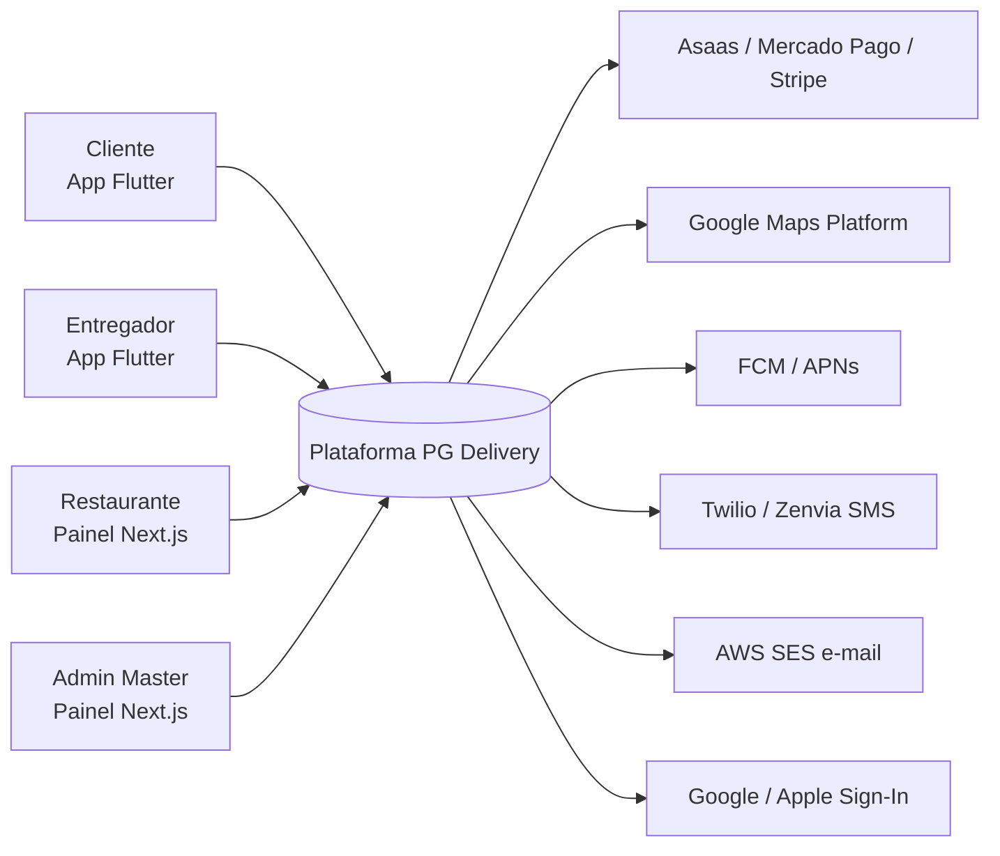
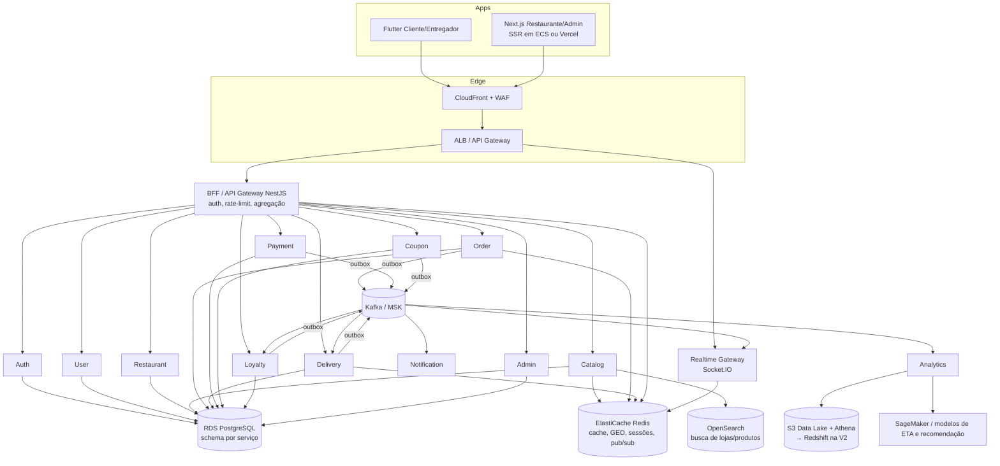
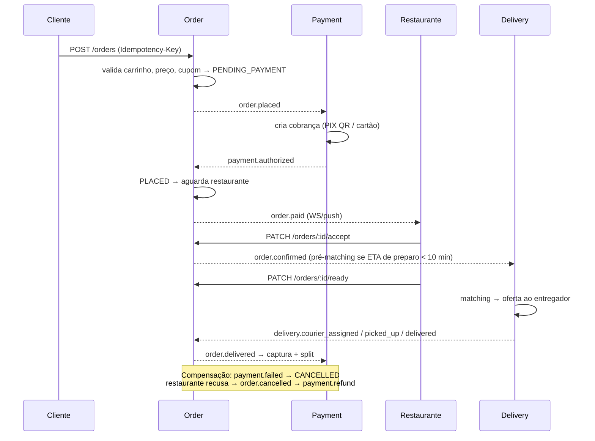
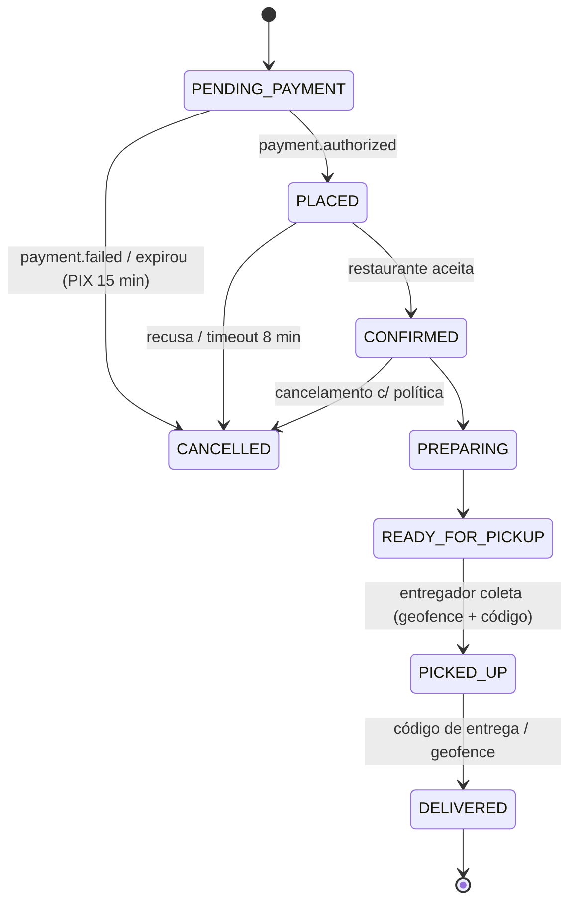
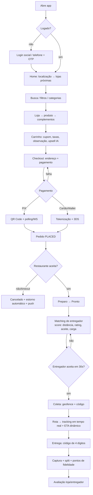

# 01 — Arquitetura

## 1. Arquitetura completa

### 1.1 Princípios

1. **Domínio primeiro (DDD).** Cada bounded context tem dono, banco lógico e contrato próprios.
2. **Event-driven por padrão.** Mudanças de estado relevantes viram eventos de domínio publicados via *Transactional Outbox*. Nenhum serviço consulta o banco de outro.
3. **CQRS onde dói.** Pedidos, catálogo e analytics separam escrita (Postgres normalizado) de leitura (projeções em Redis/OpenSearch/réplicas).
4. **Evolução incremental.** O MVP roda como **monólito modular**, com os 12 módulos já separados nas fronteiras dos microsserviços. A extração acontece quando um módulo tiver necessidade própria de escala, deploy ou equipe (ordem prevista: Delivery/Tracking → Payment → Notification → Order).
5. **Mobile offline-first.** Cache local (Drift/Isar), fila de comandos e sincronização idempotente via `Idempotency-Key`.
6. **Segurança e LGPD by design.** PII criptografada, retenção definida e trilha de auditoria.

### 1.2 Visão de contexto (C4 nível 1)



### 1.3 Visão de containers (C4 nível 2)



### 1.4 Camadas internas de cada serviço (Clean Architecture)

```
presentation   → controllers REST, gateways WS, consumers Kafka, DTOs, validação
application    → commands, queries, handlers (CQRS), orquestração de casos de uso
domain         → entidades, agregados, value objects, eventos de domínio, regras; sem dependência de framework
infrastructure → repositórios Prisma, clientes HTTP, producer Kafka, outbox, cache
```

A regra de dependência aponta sempre para dentro: o `domain` não importa nada de NestJS nem de Prisma.

## 2. Arquitetura de microsserviços

| Serviço | Responsabilidade | Dados próprios | Publica | Consome | Escala por |
|---|---|---|---|---|---|
| **Auth** | Cadastro, login, OAuth (Google/Apple), OTP SMS, MFA, JWT/refresh, revogação | `credentials`, `refresh_tokens`, `mfa` | `user.registered` | — | RPS de login |
| **User** | Perfis de cliente/entregador, endereços, cartões tokenizados, favoritos, consentimentos LGPD | `users`, `addresses`, `couriers`, `documents` | `courier.approved` | `user.registered` | Baixo |
| **Restaurant** | Lojas, horários, área de entrega (polígonos), status aberto/fechado, equipe | `restaurants`, `opening_hours`, `delivery_zones` | `restaurant.opened/closed` | — | Baixo |
| **Catalog** | Cardápio, categorias, produtos, complementos, estoque, busca | `products`, `option_groups`, `stock` | `catalog.product.updated` | `restaurant.*` | Leitura altíssima (cache + CDN) |
| **Order** | Carrinho, checkout, máquina de estados do pedido, saga | `carts`, `orders`, `order_items`, `order_status_history` | `order.*` | `payment.*`, `delivery.*` | Picos de almoço/jantar |
| **Delivery** | Matching de entregador, ofertas, rotas, tracking, geofencing, ETA | `deliveries`, `offers`, `courier_locations` (TS) | `delivery.*`, `courier.location.updated` | `order.confirmed`, `order.ready` | GPS (milhares de msg/s) |
| **Payment** | Cobrança, PIX, cartões, wallet, split, reembolso, chargeback, conciliação | `payments`, `refunds`, `ledger_entries`, `payouts` | `payment.*` | `order.placed`, `order.cancelled` | Picos |
| **Notification** | Push, SMS, e-mail, in-app, templates, preferências | `notifications`, `templates` | — | quase tudo | Fan-out |
| **Coupon** | Cupons, campanhas, regras de elegibilidade, limites | `coupons`, `redemptions` | `coupon.redeemed` | `order.placed/cancelled` | Picos de campanha |
| **Loyalty** | Pontos, cashback, níveis | `loyalty_accounts`, `loyalty_ledger` | `loyalty.points.earned` | `order.delivered` | Baixo |
| **Analytics** | Ingestão de eventos, KPIs, BI, features para IA | Data lake (S3/Parquet) | `insight.generated` | todos | Batch/stream |
| **Admin** | Backoffice, RBAC, auditoria, configurações globais (taxas, banners) | `admin_users`, `audit_log`, `settings` | `settings.updated` | — | Baixo |

**Comunicação**

- **Síncrona (REST/gRPC interno)**: só para consultas que bloqueiam o usuário, como Order → Catalog para validar preço no checkout. Sempre com timeout de 300–800 ms, *circuit breaker* e *retry* com *jitter*.
- **Assíncrona (Kafka)**: todo o resto. O padrão é *at-least-once* com consumidores idempotentes, usando a tabela `processed_events(event_id)`.

### 2.1 Saga do pedido (orquestrada pelo Order Service)



### 2.2 Máquina de estados do pedido



## 3. Fluxograma geral



---

## Kafka × RabbitMQ: qual usar num marketplace de delivery?

**Recomendação: Kafka (Amazon MSK) como barramento de eventos de domínio.** Para filas de trabalho pontuais (envio de e-mail com retry, geração de relatório), SQS dá conta, o que dispensa operar um RabbitMQ.

| Critério | Kafka | RabbitMQ | Impacto no delivery |
|---|---|---|---|
| Modelo | Log distribuído, retenção configurável | Broker de filas; a mensagem some após o ack | O Analytics, a IA e a antifraude precisam **reler** eventos (replay, backfill) |
| Ordenação | Garantida **por partição** (chave = `orderId`/`courierId`) | Por fila, e se perde com vários consumidores | Os estados do pedido **não podem** chegar fora de ordem |
| Throughput | Milhões de msg/s com particionamento | Dezenas de milhares de msg/s por nó | GPS: 10 mil entregadores × 1 ping a cada 4 s ≈ 2,5 mil msg/s só de localização, com crescimento nacional |
| Múltiplos consumidores | Consumer groups independentes, sem custo extra | Exige exchanges/filas duplicadas | Um `order.delivered` é lido por Payment, Loyalty, Notification, Analytics e Delivery |
| Stream processing | Kafka Streams/Flink, ksqlDB | Não tem | ETA dinâmico, heat maps e detecção de fraude em janela de tempo |
| Roteamento complexo/RPC | Fraco | Excelente (topic/headers exchange, prioridades) | Pouco necessário |
| Operação | Mais complexa, mitigada pelo MSK/MSK Serverless | Mais simples | O gerenciado neutraliza a diferença |

O fator decisivo é que pedidos e localização são **streams de fatos ordenados por entidade** com muitos leitores. É exatamente esse o modelo do Kafka. O RabbitMQ seria a escolha certa num sistema dominado por *task queues* com roteamento sofisticado, o que não é o caso aqui.

---

## 17. Estratégia de escalabilidade

**Meta de capacidade da V2:** 50 mil usuários simultâneos, 3 mil pedidos/min no pico, 20 mil entregadores online.

| Camada | Estratégia |
|---|---|
| Edge | CloudFront (cache de imagens do cardápio, TTL longo + *cache busting*), WAF, compressão Brotli |
| API | Stateless; HPA/ECS autoscaling por CPU e **RPS por alvo**; *scale-out* agendado antes do almoço (10h30) e do jantar (18h) |
| Leitura de catálogo | Cache em camadas: CDN → Redis (`catalog:restaurant:{id}` com invalidação por evento) → réplica de leitura. Meta: > 95% de hit |
| Busca | OpenSearch com `geo_distance` + filtros; indexação via eventos |
| Pedidos | Escrita no primário; o histórico vem de réplica; `orders` **particionada por mês** (range em `created_at`) |
| Localização | Pings → Kafka → Redis GEO (`GEOADD couriers:{city}`) para matching; persistência amostrada (1 a cada 15 s) em tabela particionada por dia, com TTL de 90 dias |
| Realtime | Socket.IO com Redis adapter; *rooms* por `order:{id}`; NLB com *sticky* opcional; 1 pod ≈ 10 mil conexões |
| Banco | RDS Multi-AZ + 2 read replicas → Aurora PostgreSQL na V2; PgBouncer/RDS Proxy; *sharding* por região (cidade) na V3 |
| Kafka | Partições = 2–3× o número de consumidores esperado; tópicos de GPS com 48 partições |
| Resiliência | Bulkheads por serviço, circuit breaker, filas de DLQ, *graceful degradation* (se a recomendação cai, mostra os mais pedidos) |
| Multi-região | V3: ativo-passivo em sa-east-1 + us-east-1 (DR com RPO de 5 min e RTO de 30 min) |
