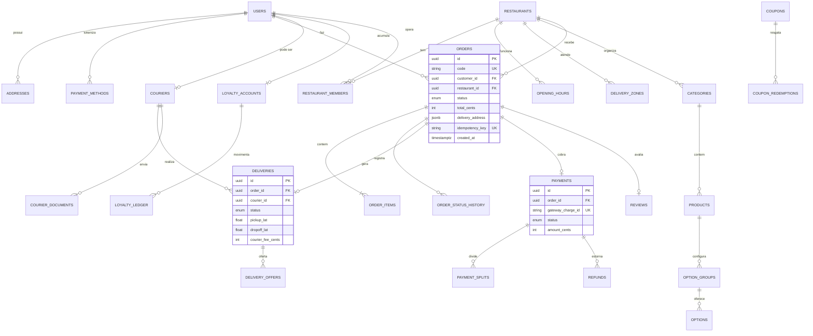

# 03 — Banco de Dados

O schema completo e executável está em [`backend/prisma/schema.prisma`](../backend/prisma/schema.prisma), com 33 tabelas em 8 schemas Postgres. Este documento explica o modelo, os índices e a estratégia de escala.

## 7. Modelo relacional

| Schema (bounded context) | Tabelas |
|---|---|
| `identity` | users, oauth_identities, refresh_tokens, addresses, payment_methods, favorites, consents, couriers, courier_documents |
| `restaurant` | restaurants, restaurant_members, opening_hours, delivery_zones (PostGIS) |
| `catalog` | categories, products, option_groups, options |
| `ordering` | orders, order_items, order_status_history, reviews |
| `delivery` | deliveries, delivery_offers, courier_locations |
| `payment` | payments, payment_splits, refunds, ledger_entries, payouts |
| `marketing` | coupons, coupon_redemptions, loyalty_accounts, loyalty_ledger |
| `platform` | outbox_events, processed_events, notifications, audit_log, settings, banners |

**Convenções**

- PKs em UUID (v4 hoje; recomendado UUIDv7 via `pg_uuidv7` para manter a localidade no índice).
- Valores monetários em **centavos (`int`)**, nunca `float`.
- `snake_case` no banco e `camelCase` no código (`@map`).
- Os pedidos guardam **snapshots** de endereço, nome e preço de produto. Assim, o histórico não muda quando o cardápio muda.
- Soft delete (`deleted_at`) apenas em `users`, por causa da LGPD: anonimiza em vez de apagar o histórico financeiro.
- Integridade entre schemas usa FK real **enquanto for monólito**. Ao extrair um serviço, a FK vira referência lógica por ID, mantida por eventos.

## 8. Diagrama ER (núcleo)



## Índices críticos (além dos declarados no Prisma)

```sql
-- Busca textual de lojas e produtos (fallback antes do OpenSearch)
CREATE INDEX idx_restaurants_name_trgm ON restaurant.restaurants USING gin (name gin_trgm_ops);
CREATE INDEX idx_products_name_trgm   ON catalog.products        USING gin (name gin_trgm_ops);

-- Proximidade: coluna geográfica gerada + GiST
ALTER TABLE restaurant.restaurants
  ADD COLUMN geo geography(Point,4326)
  GENERATED ALWAYS AS (ST_SetSRID(ST_MakePoint(longitude, latitude),4326)::geography) STORED;
CREATE INDEX idx_restaurants_geo ON restaurant.restaurants USING gist (geo);
CREATE INDEX idx_delivery_zones_area ON restaurant.delivery_zones USING gist (area);

-- Pedidos ativos (índice parcial: pequeno e quente)
CREATE INDEX idx_orders_active ON ordering.orders (restaurant_id, created_at DESC)
  WHERE status IN ('PLACED','CONFIRMED','PREPARING','READY_FOR_PICKUP','PICKED_UP');

-- Relay da outbox
CREATE INDEX idx_outbox_pending ON platform.outbox_events (created_at) WHERE published_at IS NULL;
```

**Consulta de lojas próximas que entregam no endereço:**

```sql
SELECT r.id, r.name, ST_Distance(r.geo, :p) AS meters, z.fee_cents
FROM restaurant.restaurants r
JOIN restaurant.delivery_zones z ON z.restaurant_id = r.id
WHERE r.is_active AND ST_DWithin(r.geo, :p, 8000)
  AND ST_Contains(z.area, :p::geometry)
ORDER BY r.is_open DESC, meters
LIMIT 50;
```

## Escalabilidade

### Particionamento

| Tabela | Estratégia | Retenção |
|---|---|---|
| `ordering.orders`, `order_items`, `order_status_history` | `PARTITION BY RANGE (created_at)` mensal, com `pg_partman` criando partições com 3 meses de antecedência | Online por 24 meses; depois vai para o S3 (Parquet) |
| `delivery.courier_locations` | Range diário | 90 dias (minimização LGPD) |
| `payment.ledger_entries` | Range mensal | 5 anos (obrigação fiscal) |
| `platform.audit_log` | Range mensal | 5 anos |
| `platform.outbox_events` | Range diário, com DROP de partições publicadas após 7 dias | 7 dias |

Em tabelas particionadas, a PK passa a ser `(id, created_at)`. A migração inicial de `orders` é escrita em SQL, porque o Prisma não gera `PARTITION BY`.

### Replicação e read replicas

- **RDS PostgreSQL Multi-AZ** (failover síncrono) no MVP → **Aurora PostgreSQL** na V2 (até 15 réplicas, failover < 30 s).
- **Roteamento**: Prisma com `@prisma/extension-read-replicas`. As queries CQRS (histórico, relatórios, dashboards) vão para a réplica e os comandos para o primário.
- **Lag tolerado**: telas de histórico aceitam até 1 s. Logo após um comando, o cliente lê o próprio pedido do primário (*read-your-writes*), usando um header `x-consistency: strong`.
- **Pool**: RDS Proxy, porque cada pod Fargate abre poucas conexões.

### Cache (Redis / ElastiCache)

| Chave | Conteúdo | TTL | Invalidação |
|---|---|---|---|
| `catalog:menu:{restaurantId}:v{version}` | Cardápio serializado | 10 min | Evento `catalog.product.updated` incrementa a versão |
| `restaurant:status:{id}` | Aberto/fechado, tempo de preparo | 60 s | `restaurant.opened/closed` |
| `geo:couriers:{city}` | Redis GEO com entregadores online | — | Ping de GPS; remoção após 60 s sem ping |
| `courier:last:{id}` | Última posição (hash) | 120 s | Ping |
| `order:track:{orderId}` | Projeção de tracking | 6 h | Eventos `order.*` e `delivery.*` |
| `ratelimit:{ip}:{route}` | Sliding window | 60 s | — |
| `idem:{key}` | Resposta de comandos idempotentes | 24 h | — |
| `session:denylist:{jti}` | Access tokens revogados | Até expirar | Logout ou reuso de refresh |

Padrões usados: *cache-aside* com proteção contra *stampede* (lock `SET NX` + *stale-while-revalidate*), Redis Cluster mode com 3 shards na V2 e Pub/Sub para o adapter do Socket.IO.
