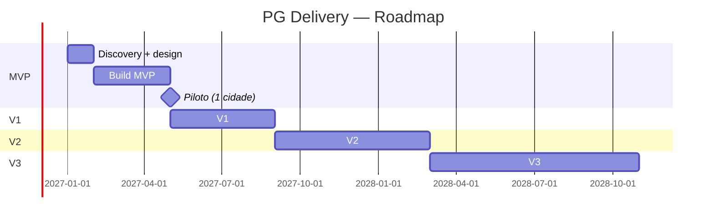

# 08 — Roadmaps

Estimativas para um time-base de 1 PM, 1 designer, 3 back-end, 2 mobile, 1 front-end, 1 DevOps/SRE e 1 QA, trabalhando em sprints de 2 semanas.

## 13. MVP: "Uma cidade, ponta a ponta" (≈ 4 meses, 8 sprints)

**Objetivo:** validar *product-market fit* numa cidade-piloto de médio porte (ex.: Volta Redonda/Barra Mansa), com 50 restaurantes, 80 entregadores e 1.500 pedidos/semana na 12ª semana.

| Área | Escopo |
|---|---|
| Cliente | Cadastro por telefone + OTP e Google; home (próximos, categorias); busca simples com filtros (distância, avaliação, frete grátis); loja/cardápio/complementos; carrinho; checkout **PIX + cartão de crédito**; tracking em tempo real; histórico; avaliação |
| Entregador | Cadastro com upload de documentos e aprovação manual; online/offline; receber, aceitar e recusar corrida (matching por proximidade); navegação delegada ao Google Maps/Waze; coleta e entrega com código; ganhos do dia |
| Restaurante | Login; abrir/pausar loja; kanban de pedidos com alerta sonoro; CRUD de cardápio; dashboard básico (pedidos, faturamento, ticket) |
| Admin | CRUD de restaurantes; aprovação de entregadores; lista de pedidos; cancelamento e reembolso manual; taxas por cidade |
| Plataforma | Monólito modular NestJS; Postgres + Redis; Kafka (MSK Serverless); outbox; Asaas com split; FCM push; ECS Fargate; CI/CD; Sentry + CloudWatch |
| Fora | Apple Pay/Google Pay, cupons avançados, fidelidade, IA, multi-cidade |

**Critérios de saída:** pedido concluído em ≥ 92% dos casos · tempo médio de entrega ≤ 40 min · crash-free ≥ 99,5% · NPS do cliente ≥ 40.

## 14. V1: "Produto competitivo" (+ 4 meses)

- Login Apple, MFA para restaurantes e admin, recuperação de senha
- **Apple Pay, Google Pay, débito, carteira PG** (saldo de reembolsos e cashback)
- **Cupons** (plataforma e loja, primeira compra, frete grátis) e **programa de pontos** (níveis Pequeno, Médio e Gigante)
- Repetir pedido, favoritos, endereços múltiplos com geocoding e validação por polígono
- Entregador: saques via PIX, ranking, métricas de performance, heatmap de demanda
- Restaurante: estoque, promoções (combos, cashback), relatórios com exportação CSV, gestão de equipe
- Admin: repasses automáticos semanais, chargebacks, banners e campanhas, auditoria
- Busca com OpenSearch (autocomplete, tolerância a erro de digitação)
- Matching v2: score por distância, rating, taxa de aceite e carga; batching de 2 pedidos da mesma loja
- **ETA v1**: modelo de regressão (LightGBM) com tempo de preparo histórico, distância e horário
- Expansão para 3 cidades da mesma região; extração dos serviços **Delivery** e **Notification**

## 15. V2: "Escala e inteligência" (+ 6 meses)

- **Recomendações** personalizadas (filtragem colaborativa + regras de negócio) na home e no carrinho (upsell)
- **Previsão de demanda e horários de pico** por região, usada para incentivo dinâmico de entregadores (bônus por zona e horário)
- **ETA dinâmico** recalculado em stream (Kafka Streams/Flink) com o trânsito do Google Routes
- **Chatbot de atendimento** (LLM com RAG sobre políticas + ferramentas: status do pedido, reembolso dentro da alçada) e FAQ automatizada
- Restaurantes patrocinados (ads com leilão por CPC e orçamento diário)
- Assinatura **PG Gigante+** (frete grátis ilimitado)
- Migração para **EKS** + Aurora + Redis Cluster; extração de Payment e Order; Debezium CDC na outbox
- Data lake (S3 + Glue + Athena) → Redshift Serverless; BI para restaurantes (Metabase embutido)
- 10–15 cidades; app do entregador com navegação própria (Google Navigation SDK)

## 16. V3: "Plataforma nacional" (+ 6–9 meses)

- **Verticais**: mercado, farmácia, pet e conveniência (catálogo com SKU/EAN e substituição de itens); "PG Envios" (coleta e entrega de pacotes)
- **Insights automáticos** para restaurantes ("seu tempo de preparo subiu 22% às sextas") e sugestões operacionais com IA
- Antifraude com ML (contas falsas, abuso de cupom, conluio entregador/cliente)
- **Multi-região** (sa-east-1 primário + DR), sharding por região, SLO de 99,95%
- API pública para PDVs e ERPs (integração com Consumer, Saipos, Anota AI), webhooks para restaurantes
- Programa de crédito para restaurantes (antecipação de recebíveis via parceiro)
- Capitais e regiões metropolitanas, com operação nacional

