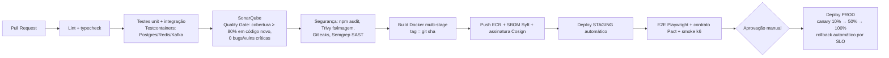

# 09 — Estratégia DevOps

## Repositório e branches

- **Monorepo** (este repositório) com Turborepo/Nx para cache de build. Pastas: `backend/`, `web/`, `mobile/`, `infra/`.
- **Trunk-based development**: branches curtas (`feat/…`, `fix/…`), PR com 1 aprovação, merge com squash na `main`. Funcionalidades incompletas ficam atrás de feature flags (Unleash ou AWS AppConfig).
- **Conventional Commits** + `release-please` geram changelog e versões semânticas.

## Pipeline (GitHub Actions): `.github/workflows/ci.yml`

| Etapa | Ferramenta |
|---|---|
| IaC | **Terraform** (`infra/terraform`) com state em S3 + lock DynamoDB; `terraform plan` comentado no PR; Checkov/tfsec |
| Ambientes | `dev` (efêmero por PR, opcional), `staging`, `prod`. Contas AWS separadas (AWS Organizations + Control Tower) |
| Containers | Dockerfile multi-stage, imagem distroless/`node:22-alpine`, usuário não-root, `HEALTHCHECK` |
| Deploy MVP | ECS Fargate + CodeDeploy blue/green |
| Deploy V2+ | EKS + **Argo CD** (GitOps) + **Argo Rollouts** (canary com análise no Prometheus) + Karpenter (nós) + KEDA (escala por lag do Kafka) |
| Banco | `prisma migrate deploy` num job antes do deploy; migrações *expand → migrate → contract* (sem downtime); nunca `DROP` no mesmo release |
| Mobile | **Codemagic** ou GitHub Actions + Fastlane: build por flavor, testes, distribuição (Firebase App Distribution → TestFlight/Play Internal → produção com *staged rollout* de 5% → 100%); **Shorebird** para *code push* de correções em Dart |
| Web | Build Next.js `output: standalone` em container no ECS (ou Vercel, se o time preferir) |
| Segredos | AWS Secrets Manager + External Secrets Operator (K8s); OIDC GitHub→AWS (sem chaves de longa duração) |

## Kubernetes (V2+): padrões obrigatórios por serviço

- `Deployment` com `readinessProbe`/`livenessProbe`/`startupProbe`, `resources.requests/limits`, `PodDisruptionBudget` (minAvailable 50%), `topologySpreadConstraints` por AZ
- `HorizontalPodAutoscaler` (CPU 60% + métrica custom de RPS) ou `ScaledObject` KEDA (lag do consumer group)
- `NetworkPolicy` com default deny; mTLS via service mesh (Istio ambient ou Linkerd) na V3
- Manifests de exemplo em `infra/k8s/`

## Ambientes locais

`infra/docker/docker-compose.yml` sobe Postgres+PostGIS, Redis, Redpanda (compatível com Kafka, mais leve), Redpanda Console, Jaeger e Grafana. Seeds com `npm run db:seed`.

## Gestão de incidentes

- Severidades S1–S4; plantão via PagerDuty/Opsgenie; *runbooks* linkados em cada alerta
- Postmortem *blameless* em até 5 dias úteis para S1/S2
- *Game days* trimestrais (falha do RDS, Kafka indisponível, gateway de pagamento fora)
