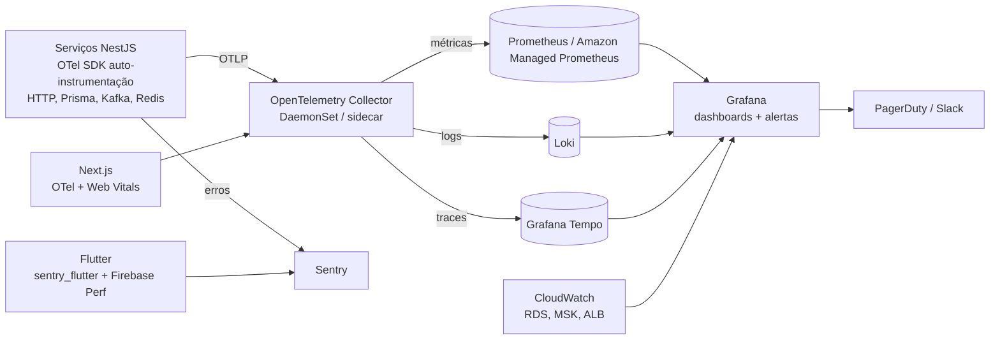

# 11 — Estratégia de Observabilidade

## Arquitetura

- **Traces:** contexto W3C propagado em HTTP e nos **headers do Kafka**. Assim, um único trace mostra checkout → payment → push. Amostragem *tail-based* no Collector: 100% de erros e de latência > 1 s, 5% do restante.
- **Logs:** JSON estruturado (Pino) com `traceId`, `spanId`, `userId` (hash), `orderId`. PII mascarada por *redaction*. Retenção de 15 dias no Loki e 1 ano no S3.
- **Métricas:** RED (Rate, Errors, Duration) por rota e consumidor; USE para infraestrutura; métricas de negócio.
- **Correlação:** clicar num pico de latência no Grafana leva ao exemplar do trace no Tempo e, dali, aos logs no Loki.

## SLOs

| SLI | SLO | Janela |
|---|---|---|
| Disponibilidade da API de checkout (`POST /orders` não-5xx) | 99,9% | 28 dias |
| Latência p95 `GET /home` | < 300 ms | 28 dias |
| Latência p95 `POST /orders` | < 800 ms | 28 dias |
| Atualização de localização visível ao cliente | p95 < 3 s | 7 dias |
| Lag do consumer `order-events` (Payment) | < 5 s em 99% do tempo | 7 dias |
| App crash-free sessions | ≥ 99,7% | 7 dias |

Alertas por **burn rate** de múltiplas janelas (ex.: 14,4× em 1 h e 6× em 6 h acionam o plantão).

## Métricas de negócio (dashboards "Operação Viva")

- Pedidos por minuto, por cidade, comparados à mesma janela da semana anterior (anomalia → alerta)
- Taxa de aprovação de pagamento por método e gateway (queda > 5 p.p. em 10 min → alerta S2)
- Tempo até o aceite do restaurante, tempo de preparo, tempo para encontrar entregador, tempo de entrega
- Pedidos sem entregador há mais de 8 min; taxa de cancelamento por motivo
- Entregadores online × demanda (razão de oferta) por zona

## Ferramentas

| Ferramenta | Papel |
|---|---|
| OpenTelemetry | Padrão único de instrumentação (sem *vendor lock-in*) |
| Prometheus (AMP) | Métricas e regras de alerta |
| Grafana (AMG) | Dashboards, alertas, SLOs (plugin Sloth/Pyrra) |
| Loki | Logs |
| Tempo | Traces (vale citar, porque fecha o trio LGTM) |
| Sentry | Erros e performance de front, mobile e backend; *release health*; *source maps* e símbolos Dart enviados no CI |
| CloudWatch | Métricas nativas dos serviços gerenciados, coletadas pelo Grafana |
